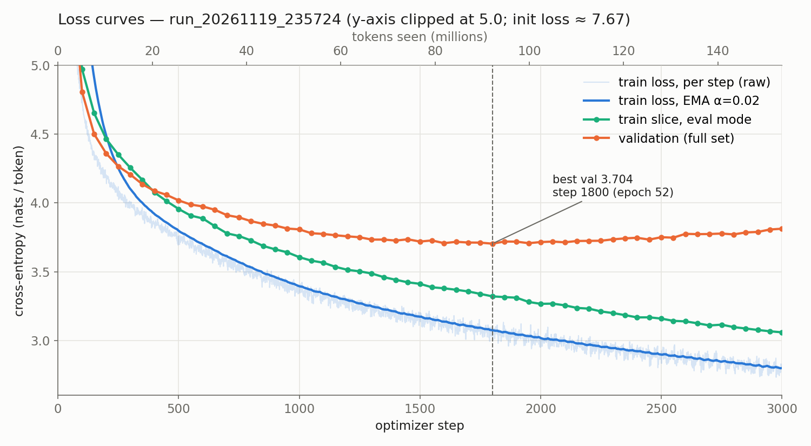

# A transformer language model built from first principles

A small decoder-only transformer written in PyTorch, where the core operations have hand-derived backward passes instead of relying on autograd. I trained it on the complete works of Shakespeare, first on a MacBook and now on an RTX 5070.

The goal was to understand every piece of a modern language model well enough to write it myself: attention, normalization, positional encoding, the training loop and the diagnostics that show whether training worked.

## What's implemented

| Component | Implementation |
|---|---|
| Architecture | Decoder-only transformer, pre-norm residual blocks |
| Attention | Multi-head causal self-attention (4 heads, d_k = 32) |
| Normalization | RMSNorm with a **hand-written backward pass** |
| Softmax | Numerically stable softmax with a **hand-written backward pass** |
| QKV projection | Batched per-head projection with a **hand-written backward pass** |
| Embedding | Lookup with a **hand-written backward pass** (scatter-add of gradients) |
| Activation | Softplus ("smooth ReLU") with a **hand-written backward pass** |
| Positional encoding | Sinusoidal |
| Tokenizer | Byte-level BPE, 2,000-token vocabulary (Hugging Face `tokenizers`) |
| Training | AdamW, LR warmup + cosine decay, dropout, random-window batching, gradient clipping (max norm 1.0), `torch.compile`, periodic evaluation, best/last checkpointing, CSV logs, loss plots |
| Inference | Temperature sampling (T = 0.8) from the last position |

Each custom op is a `torch.autograd.Function` whose `backward` I derived on paper. For example, for RMSNorm y = γ · x / rms(x), the input gradient is

```
dL/dx = (g·γ) / rms  −  x · Σ(g·γ·x) / (d · rms³)
```

## First run

Model: 1.30M parameters (4 layers, width 128, 512-token context). Data: 1.78M training tokens, 30k validation tokens. Training took 2 h 16 min on Apple Silicon (MPS) at about 19k tokens/s.

| Model | Validation loss (nats/token) |
|---|---|
| Uniform guess | 7.60 |
| Unigram baseline | 6.13 |
| Bigram baseline | 4.31 |
| **This transformer (best checkpoint)** | **3.70** (perplexity 40.6, 1.85 bits/byte) |



**What I learned from the run.** Validation loss bottomed out at step 1800 and then rose while training loss kept falling. The model saw its training set 86 times, and the train–validation gap grew almost linearly from step ~400. That is classic overfitting from data repetition. Training itself was stable, with no loss spikes.


## Experiments since the first run

Same model and data, 3,000 steps each, now trained on an RTX 5070 (CUDA): the same run takes about 10 minutes there, against 2 h 16 min on the MacBook.

| Run | Best validation loss | Final train–val gap |
|---|---|---|
| Baseline (constant LR) | 3.704 | 0.75 |
| + LR warmup and cosine decay | 3.706 | 0.43 |
| + Dropout 0.1 (attention and residual) | 3.673 | 0.21 |
| + Random-window batching | **3.655** | **0.11** |

Warmup and cosine decay barely moved the best validation loss. Dropout gave the best result so far and cut the overfitting gap by more than two thirds, so it's now on by default. I also tried tying the input embedding and output layer weights; at this size it made results noticeably worse, so I've left it out for now and will retry it at GPT-2 scale.

Random-window batching re-chunks the training tokens at a fresh random offset every epoch instead of reusing the same fixed 512-token chunks. On top of dropout it lowered the best validation loss again and roughly halved the remaining gap. Training loss went up slightly while validation loss went down, which is what a regularizer should do. The improvement is about the size of seed-to-seed noise at this scale, so I still want to confirm it with a second seed.

## Current work

**Now:** finishing the Shakespeare model. Since the last update I added random-window batching, turned on real gradient clipping, and reworked the custom autograd functions so the model runs under `torch.compile`. The sampler now produces play-formatted Shakespeare with speaker tags and mostly grammatical lines, though the meaning drifts. What's left: giving the tokenizer trainer the full byte-level alphabet so unseen characters never break encoding, and a second seed to confirm the random-window result.

**Roadmap:** I'm working through a staged plan from this model toward a modern LLM:

1. **The GPT recipe:** my own BPE tokenizer, a GPT-2 small (124M) model trained on FineWeb-Edu on the 5070
2. **Scaling laws:** a small-model sweep, fitted loss curves, μP
3. **Llama-style block:** SwiGLU, RoPE, grouped-query attention, KV cache
4. **Speed and long context:** profiling, FlashAttention, the Muon optimizer

## Files

| File | Purpose |
|---|---|
| `Transformer.py` | Model and custom autograd functions |
| `Training.py` | Training loop, evaluation, logging, checkpoints |
| `Inference.py` | Generate text from a prompt |
| `byte_pair_encoding.py` | Train the BPE tokenizer |
| `test.py` | `gradcheck` harness for a custom autograd function |

## Running it

```bash
pip install torch tokenizers matplotlib
python byte_pair_encoding.py   # train the tokenizer
python Training.py             # train the model
python Inference.py            # generate text
```
