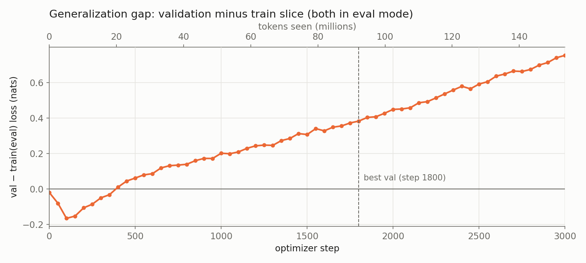

# A transformer language model built from first principles

A small decoder-only transformer written in PyTorch, where the core operations have hand-derived backward passes instead of relying on autograd. I trained it on the complete works of Shakespeare on a MacBook.

The goal was to understand every piece of a modern language model well enough to write it myself: attention, normalization, positional encoding, the training loop and the diagnostics that show whether training worked.

## What's implemented

| Component | Implementation |
|---|---|
| Architecture | Decoder-only transformer, pre-norm residual blocks |
| Attention | Multi-head causal self-attention (4 heads, d_k = 32) |
| Normalization | RMSNorm with a **hand-written backward pass** |
| Softmax | Numerically stable softmax with a **hand-written backward pass** |
| QKV projection | Batched per-head projection with a **hand-written backward pass** |
| Embedding | Lookup with a **hand-written backward pass** (scatter-add of gradients) |
| Activation | Softplus ("smooth ReLU") with a **hand-written backward pass** |
| Positional encoding | Sinusoidal |
| Tokenizer | Byte-level BPE, 2,000-token vocabulary (Hugging Face `tokenizers`) |
| Training | AdamW, periodic evaluation, best/last checkpointing, CSV logs, loss plots |
| Inference | Temperature sampling |

Each custom op is a `torch.autograd.Function` whose `backward` I derived on paper. For example, for RMSNorm y = γ · x / rms(x), the input gradient is

```
dL/dx = (g·γ) / rms  −  x · Σ(g·γ·x) / (d · rms³)
```

## Results

Model: 1.30M parameters (4 layers, width 128, 512-token context). Data: 1.78M training tokens, 30k validation tokens. Training took 2 h 16 min on Apple Silicon (MPS) at about 19k tokens/s.

| Model | Validation loss (nats/token) |
|---|---|
| Uniform guess | 7.60 |
| Unigram baseline | 6.13 |
| Bigram baseline | 4.31 |
| **This transformer (best checkpoint)** | **3.70** (perplexity 40.6, 1.85 bits/byte) |


**What I learned from the run.** Validation loss bottomed out at step 1800 and then rose while training loss kept falling. The model saw its training set 86 times, and the train–validation gap grew almost linearly from step ~400. That is classic overfitting from data repetition. Training itself was stable, with no loss spikes.



## Next experiments

1. Early stopping on validation loss
2. More training data
3. Dropout and weight decay that excludes norm gains
4. Learning-rate warmup and cosine decay
5. Weight tying between the input embedding and output layer (~39% of parameters are in those two tables)
6. Benchmark the custom ops against PyTorch's fused `scaled_dot_product_attention`

## Files

| File | Purpose |
|---|---|
| `Transformer.py` | Model and custom autograd functions |
| `Training.py` | Training loop, evaluation, logging, checkpoints |
| `Validation.py` | Evaluate a saved checkpoint |
| `Inference.py` | Generate text from a prompt |
| `byte_pair_encoding.py` | Train the BPE tokenizer |

## Running it

```bash
pip install torch tokenizers matplotlib
python byte_pair_encoding.py   # train the tokenizer
python Training.py             # train the model
python Inference.py            # generate text
```
